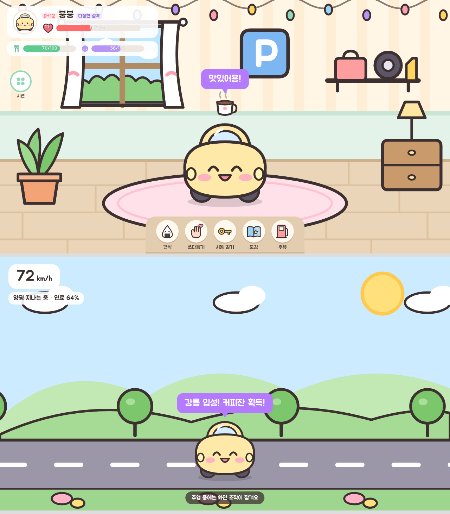

# 붕붕 – 운전하는 대로 자라는 내 차 캐릭터

현대자동차그룹 차량용 앱 개발 공모전 출품작 (Pleos Connect / Android Automotive)

## 조작 방법

- **위쪽**: 붕붕이 얼굴, 함께한 날(D+n), 성격, 레벨 하트와 경험치, 배부름·친밀도 게이지
- **왼쪽 동그라미**: 상태(성격·누적 거리·도감 수), 시연 도구(3일 뒤로 가기, 처음부터 다시)
- **아래 메뉴**: 간식 · 쓰다듬기 · 가운데 열쇠(시동 걸기 → 출발 → 시동 끄기) · 도감 · 주유
- 붕붕이를 직접 눌러도 쓰다듬기가 돼요.
- 간식·쓰다듬기·도감·주유는 주차(P) 중에만 돼요. 주행 중에는 화면 조작이 잠기고 음성·상단 알림만 나와요.

### 판단 기준

| 항목 | 기준 |
|---|---|
| 급제동 | 1초에 9 km/h 이상 감속 (15 km/h 이상 달리던 중) |
| 급가속 | 1초에 11 km/h 이상 가속 |
| 성격 | 부드러운 주행 +4, 급제동 1회 −4, 급가속 1회 −3 (−100 겁 많음 ~ +100 다정함) |
| 경험치 | 1 km = 10 경험치. 레벨 n에 필요한 누적 경험치 = 50·n·(n−1) |
| 삐짐 | 3일 이상 안 타면 삐지고 친밀도가 줄어듦 |
| 컨디션 | 차량 경고 → 아픔, 타이어 이상 → 발 아픔, 연료 15% 미만 → 배고픔 |

